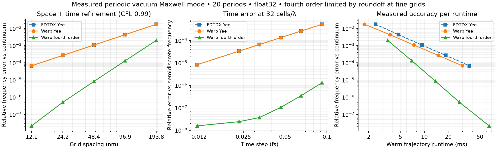

# Warp FDTD

Pure NVIDIA Warp 3D electromagnetic solver, compared against pinned, unmodified
FDTDX. The implemented flagship is a silicon 90° waveguide bend with all six E/H
components, CPML, an injected mode, and Hann-window modal detectors.

**Status:** forward correctness gates pass on the saved cases. On the tested
RTX PRO 6000 Blackwell **MIG 1g.24gb** (46 SMs), matched forward runs are
**2.30–4.05× faster**. Fine-grid bend transmission is **93.1919%**.
The smooth periodic test measures order **3.97** with Warp’s optional fourth-order propagator versus **2.01** with Yee. This higher-order path is not yet validated for dielectric interfaces or CPML.

| Matched workload | FDTDX | Warp | Speedup |
|---|---:|---:|---:|
| 192k cells, flux | 0.200 s | 0.049 s | 4.05× |
| 3M cells, modal | 14.683 s | 4.533 s | 3.24× |
| 24M cells, flux | 132.144 s | 57.471 s | 2.30× |
| 24M cells, modal | 316.138 s | 106.640 s | 2.96× |

The validated 3M-cell material gradient is **1.98× faster** than FDTDX’s fast adjoint, with **1.85e-06** relative gradient error. It uses **8.06 GB** of history, a memory tradeoff.





The flow panels use one common scale; vector-field relative L2 difference is
**4.51e-07**. These are slices of full 3D simulations. Timing excludes setup,
compilation and host postprocessing; raw repeats and limitations are in
[measurement details](docs/warp.md). No general superiority claim is made for
untested geometries, hardware, boundaries or gradients.

```bash
uv venv --python 3.12 .venv-warp
uv pip install --python .venv-warp/bin/python -r requirements-warp.txt
.venv-warp/bin/python -m unittest discover -s tests -v
.venv-warp/bin/python -m warp_fdtd.benchmark
```

[Prioritized issues](https://github.com/alecjacobson/warp-fdtd/issues) ·
[Solver and reproduction](docs/warp.md) ·
[FDTDX baseline methodology](docs/fdtdx-baseline.md) ·
[Raw results](results/warp)
