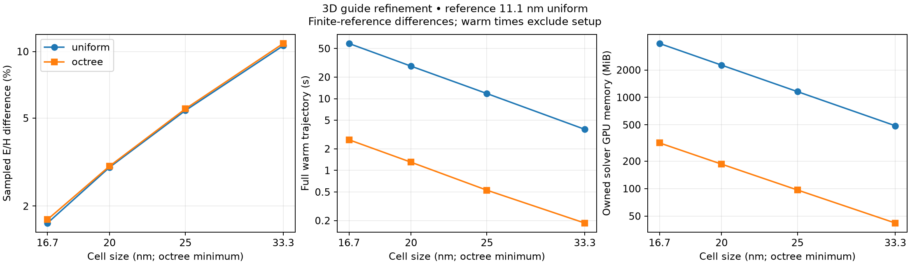
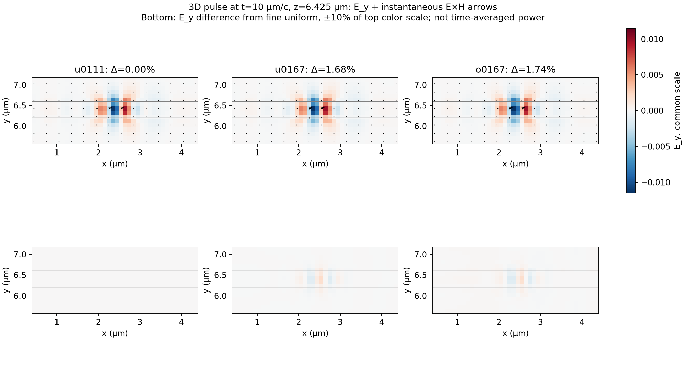
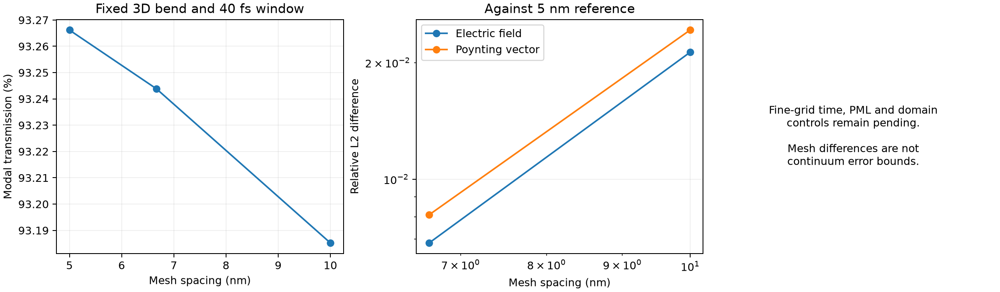
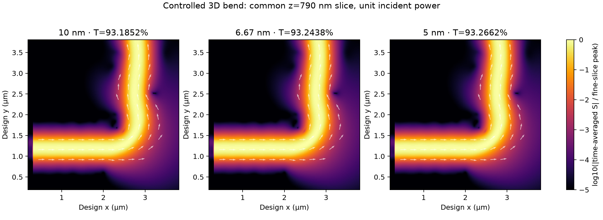

# Warp FDTD

Pure NVIDIA Warp 3D electromagnetics, with uniform FDTDX comparisons and a
binary-octree waveguide prototype.

**Latest 3D guide sweep: 20.3–22.3× faster at the same minimum cell size, with
11.7–12.3× less solver GPU memory.** All four octrees use the same physical guide
and 780 identical leaf blocks; the field resolution inside those blocks increases.

| Minimum cell | Uniform field Δ | Octree field Δ | Uniform time | Octree time |
|---|---:|---:|---:|---:|
| 33.3 nm | 10.63% | 10.87% | 3.739 s | 0.185 s |
| 25 nm | 5.41% | 5.51% | 11.791 s | 0.530 s |
| 20 nm | 3.00% | 3.03% | 28.424 s | 1.301 s |
| 16.7 nm | 1.68% | 1.74% | 58.816 s | 2.673 s |

Field Δ is the sampled E/H difference from an **11.11 nm / 573.3M-cell reference**.
The previous 12.5 nm reference differs by 0.38%; continuum accuracy remains
unqualified. At a strict measured error budget, the 16.7 nm octree is **more
accurate than the 20 nm uniform case and 10.6× faster**, using 7.1× less GPU memory.

**Prototype limits:** sponge/interface flux consistency still fails. CPU setup
costs 14.6–123.7 s across this sweep, so a fresh one-shot solve remains slower.
Warm timings include source and sponge updates and exclude setup and diagnostics.

[Full trends, meshes, raw data and reproduction](docs/octree-refinement.md) ·
[Flux fix #42](https://github.com/alecjacobson/warp-fdtd/issues/42) ·
[Setup cost #43](https://github.com/alecjacobson/warp-fdtd/issues/43)

**Optimized 3D bend versus pinned FDTDX:** matched forward runs remain
**2.96–3.24× faster**, with uniform Yee grids, CPML and modal sources/detectors.
The fixed-geometry reference reaches 93.2662% transmission at 5 nm / 192M cells;
the 6.67 nm electric-field difference is 0.685% and power-flow difference 0.809%.

Measurements use an RTX PRO 6000 Blackwell **MIG 1g.24gb**, float32 and serial
synchronized GPU runs. Warm timings exclude setup, compilation and diagnostics.

[Bend reproduction](docs/warp.md) · [Reference accuracy](docs/physical-reference.md) ·
[Prioritized work](https://github.com/alecjacobson/warp-fdtd/issues)
