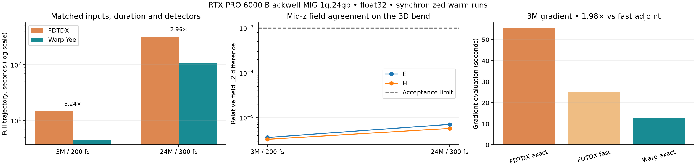
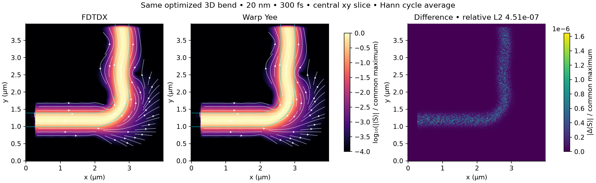

# Warp FDTD

Pure NVIDIA Warp 3D electromagnetic solver, compared with pinned, unmodified
FDTDX on an optimized silicon 90° waveguide bend. The flagship uses explicit
Yee updates, a uniform grid, CPML, injected modes and Hann-window modal detectors.

**Measured status:** **2.96–3.24× faster** matched forward runs;
**93.1919%** fine-grid transmission. Adaptive flagship results are pending.

| Same-input flagship workload | FDTDX | Warp | Speedup |
|---|---:|---:|---:|
| 20 nm · 3M cells · 200 fs | 14.683 s | 4.534 s | 3.24× |
| 10 nm · 24M cells · 300 fs | 316.138 s | 106.709 s | 2.96× |

Field agreement is against FDTDX, not continuum ground truth. These archived
mesh levels have slightly different source/output positions; controlled physical
convergence is tracked in [#25](https://github.com/alecjacobson/warp-fdtd/issues/25).
The 3M-cell material gradient is **1.98× faster** than
FDTDX's fast adjoint, with **1.85e-06** relative gradient error
and **8.06 GB** of stored history.

Common-scale central slices of the full 3D bend, 20 nm / 300 fs. Poynting-vector
relative L2 difference: **4.51e-07**. Measurements use an RTX PRO 6000 Blackwell
**MIG 1g.24gb**, float32, synchronized warm runs; timings exclude compilation,
setup and host postprocessing.

[Reproduction and limitations](docs/warp.md) ·
[Adaptivity progress](docs/adaptivity-progress.md) ·
[Prioritized issues](https://github.com/alecjacobson/warp-fdtd/issues) ·
[Raw results](results/warp)
