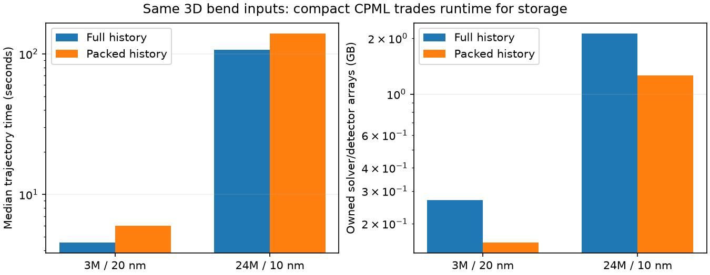
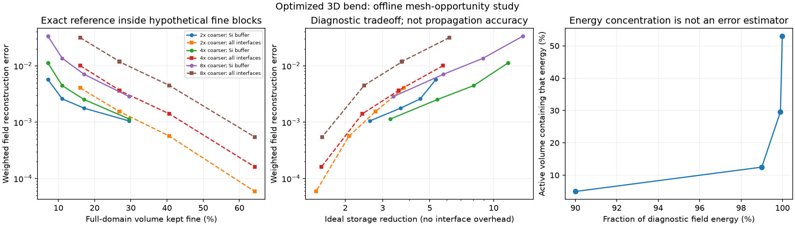

# Adaptivity implementation progress

The user authorized the research priorities on 2026-10-22. The target is roughly
10× forward runtime and memory improvement over the best accuracy-matched
uniform Warp configuration, with 30–100× explored on larger sparse domains.
These are targets, not measured adaptive results. Static 3D refinement precedes
local time stepping; source, port, PML and material errors remain part of the
acceptance contract in [the research review](adaptivity-research.md).

## Uniform storage control (#23)

`--cpml-storage packed` allocates histories only for active planes of each axis,
with separate E/H layouts. Six histories per field are padded to the largest
axis slab. The default `full` layout remains the faster baseline and is also the
path used by the current adjoint. Packing is an optional uniform-grid storage
tradeoff, not an adaptive-grid improvement.

Tests compare all active history values and E/H bitwise on asymmetric layouts,
then full fields/flux and reset/replay against the saved 192k-cell fixture.
Flagship tests include the same sources and detectors in both timed paths.
Array accounting deduplicates allocations and includes fields, coefficients,
source data, history and monitors; it **does not measure peak device memory**
or allocator/graph/driver overhead.

Five synchronized warm repetitions per path on the same MIG GPU:

| Grid | Full history | Packed history | Owned arrays: full / packed | Storage reduction |
|---|---:|---:|---:|---:|
| 20 nm | 4.534 s | 6.008 s | 267.2 / 157.7 MB | 1.69× |
| 10 nm | 106.709 s | 139.685 s | 2124.2 / 1264.0 MB | 1.68× |

All saved flagship field slices and modal phasor arrays are bitwise identical
between the two paths. Raw repeat times are in `packed_control*/result.json`;
the duplicate NPZ files are ignored by Git, with parity hashes retained in
[`storage_control/result.json`](../results/warp/storage_control/result.json).
The compact path is 31–33% slower. [#26](https://github.com/alecjacobson/warp-fdtd/issues/26)
tracks recovery of that throughput before any default change.



```bash
for spacing in 20 10; do
  case=results/warp_reference/hann_200fs
  if [ "$spacing" = 10 ]; then case=results/warp_reference/hann_10nm; fi
  for storage in full packed; do
    OPENBLAS_NUM_THREADS=1 taskset -c 0-3 .venv/bin/python -m warp_fdtd.benchmark \
      --case "$case" --output "results/warp/packed_control${spacing}_${storage}" \
      --cpml-storage "$storage" --reps 5
  done
done
OPENBLAS_NUM_THREADS=1 .venv/bin/python -m warp_fdtd.storage_control
```

## Physical-coordinate volume observer (#24)

`warp_fdtd.volume` records all six complex phasors at common physical points.
Trilinear interpolation accounts for Yee staggering, and H is centered using
its old and new states before applying the existing detector's Hann weights.
Independent affine-field interpolation/time-centering tests and a random-field
comparison against the legacy plane sampler cover the observation operation.
On the actual bend, modal transmission and the existing central flow plane are
also checked. This is a passive diagnostic with its own reported cost; it is
not included in throughput claims from ordinary forward benchmarks.

The large phasor chunks are ignored by Git. `results/warp/volume20/result.json`
records their checksums, axes, source bundle, window and code hashes. Regenerate:

```bash
OPENBLAS_NUM_THREADS=1 .venv/bin/python -m warp_fdtd.volume
OPENBLAS_NUM_THREADS=1 .venv/bin/python -m warp_fdtd.opportunity
```

The opportunity study retains the exact reference inside hypothetical fine
blocks and linearly reconstructs coarse samples elsewhere. It sweeps ratios
2/4/8, material buffers 0/40/80/160/320 nm and blocks of 4/8/16 fine cells. Errors
use complex phase and epsilon-weighted fields over native-grid samples,
excluding a 200 nm boundary margin. The common uniform quadrature volume
cancels in the relative norm. Silicon-only and all-material-interface masks
show the cost of resolving the flat substrate as well as the guides.

**This tests field representation, not Maxwell evolution.** Ideal cell/work
ratios omit interface, CPML, source, monitor and scheduling costs. Even a small
reconstruction error cannot certify a stable or accurate coarse–fine update.
Fine-volume fraction, one-cell block halos and retained covered parent cells
are reported separately rather than treating all storage estimates as equal.

Measured on the 3M-cell optimized bend: the volume sampler differs from the
existing central-plane phasors by **4.23e-8 relative L2**; modal transmission
differs from FDTDX by **1.30e-7 absolute**. One diagnostic trajectory took
10.56 s including volume sampling, without claiming a repeated throughput result.

Within the boundary-excluded volume, 90% of diagnostic energy occupies 4.96%
of samples; 99% occupies 12.49%, and 99.99% occupies 53.00%. Low amplitude
therefore does not justify simply deleting most of the domain at tight tolerance.

The best *ideal-cell-count* candidate below 1% reconstruction error uses 4×
coarser spacing outside silicon plus an 80 nm buffer, in 4³-cell blocks:
**8.46% fine volume, 0.632% reconstruction error, 10.11× ideal storage ratio**.
Adding one fine-cell halo to every such small block reduces the estimated
storage ratio to **3.34×**, before other costs. With 8³ blocks the corresponding
figures are 11.06%, 0.443%, 8.03× ideal and 4.35× with that halo model.
Resolving all material interfaces changes the tradeoff further. None of these
ratios includes a validated adaptive CPML or source/port treatment.

This supports testing larger/coalesced blocks and avoiding needless refinement
of flat, well-resolved interfaces. It does not justify selecting a production
mesh from this single reference. Incompatible block-size/coarsening-ratio pairs
are excluded; clipped domain-edge cells still make the cell ratios approximate.



## Nonuniform verification control (#13, #14)

`RectilinearPeriodic` is a hand-written pure-Warp explicit 3D Yee operator with
primal/dual spacing and componentwise diagonal permittivity. It supports static
tensor-product grids and periodic boundaries. It does not yet support flagship
sources, ports, CPML, material-interface averaging or local block refinement.
The forward flagship backend remains unchanged in scope.

`warp_fdtd.adaptive_validation` tests an analytic oblique vacuum standing wave
on 8³–64³ uniform and smoothly graded grids. It also assembles an independent
small NumPy operator and checks the weighted curl transpose, modified-energy
invariant, positive energy matrix and amplification spectrum over 12 CFL values.
A seeded broadband discrete-curl state stresses a graded 8³ grid for one million
steps, with ten energy/Gauss checkpoints. The proper leapfrog modified energy,
not instantaneous unstaggered physical energy, is the conservation test.

```bash
OPENBLAS_NUM_THREADS=1 .venv/bin/python -m unittest discover -s tests -v
OPENBLAS_NUM_THREADS=1 .venv/bin/python -m warp_fdtd.adaptive_validation
```

These tests do not certify block boundaries or dielectric scattering. Slab,
sphere, artificial-interface reflection and fixed-geometry bend uncertainty
remain open under #13–#15.

Measured convergence is second order: uniform **2.004**, graded **1.995**.
The tiny independent operator's weighted-transpose residual is **1.20e-16**,
and all 12 tested CFL values pass the matrix checks. Long-time results:

| Arithmetic | Maximum modified-energy drift | Maximum normalized Gauss residual | Shared gate |
|---|---:|---:|---|
| float32 | 3.55e-6 | 9.02e-4 | **Fail** (Gauss) |
| Compensated float32 | 2.18e-6 | 7.73e-4 | **Fail** (Gauss) |
| float64 | 6.77e-15 | 1.62e-12 | Pass for this restricted control |

The limit is 1e-4 for both quantities. Compensation stores two additional
three-component arrays and does not solve this failure. Float64 is a correctness
control, not a demonstrated competitive production policy. [#27](https://github.com/alecjacobson/warp-fdtd/issues/27)
tracks metric-consistent flux storage, mixed precision and further robustness
sweeps. The failing float32 commands intentionally exit nonzero after writing
their result files. The initial failed run is also retained, with its overly
sensitive smooth-wave normalization superseded: smooth-wave Gauss changes now
use the initial combined E/H norm instead of E at a standing-wave temporal node.

```bash
# Expected to fail the long-time Gauss gate, with results retained:
OPENBLAS_NUM_THREADS=1 .venv/bin/python -m warp_fdtd.adaptive_validation
OPENBLAS_NUM_THREADS=1 .venv/bin/python -m warp_fdtd.adaptive_validation \
  --compensated --output results/warp/adaptive_validation_compensated
# Passing precision control:
OPENBLAS_NUM_THREADS=1 .venv/bin/python -m warp_fdtd.adaptive_validation \
  --precision float64 --output results/warp/adaptive_validation_float64
```

The regression suite passes **13 tests**, including unequal-axis/material
NumPy comparisons, all three arithmetic modes, and preservation of compensation
state across graph compilation and reset/replay.

## Reference audit (#25)

The saved 20 nm and 10 nm flagship bundles both have 200 nm PML and the input
modal plane at 400 nm. Their source anchors differ (260 vs 230 nm), as do the
output anchors (3680 vs 3740 nm). Their durations also differ (200 vs 300 fs).
They remain valid same-input Warp/FDTDX comparisons. Their difference is not
an isolated spatial truncation error.

`python -m warp_fdtd.reference_contract` verifies bundle hashes and writes the
physical-plane audit. `--require-matched-planes` rejects this archived pair.
A passing plane audit alone would not certify geometry, material mapping,
source normalization, time windows, PML/domain convergence or reference accuracy.
A separate fixed-physical-geometry reference protocol and at least three mesh
levels remain prerequisites for accepting an adaptive flagship result.

## Next dependencies

1. #25: create fixed-physical-geometry bend references and quantify their uncertainty.
2. #27 and #13: resolve long-time float32 constraints and add slab/sphere scattering.
3. #14: extend nonuniform controls to materials, sources, ports and CPML.
4. #15: implement and audit the 3D 3:1 block interface, including face/edge/corner power and divergence tests.
5. #16: add local time stepping only after the spatial interface passes.

#26 is an independent uniform-throughput control. #18 consumes the localization
diagnostic but still needs a calibrated propagation-error estimator. Main README
figures remain measured flagship results; no adaptive speedup is advertised.
