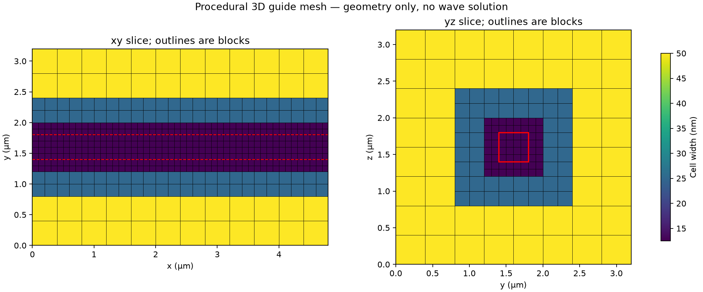
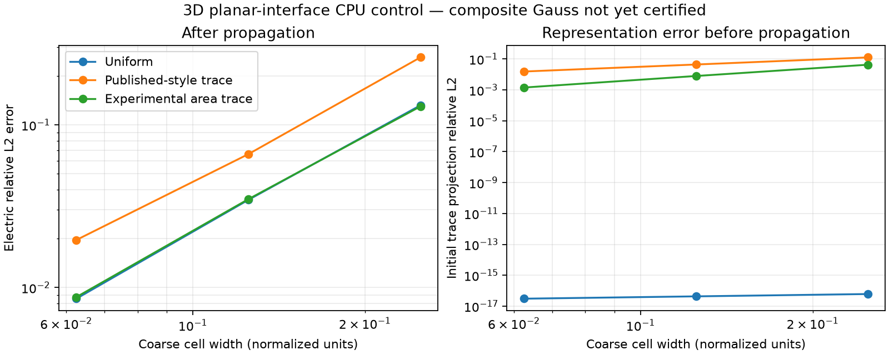

# Adaptivity implementation progress

The user authorized the research priorities on 2026-10-22. The target is roughly
10× forward runtime and memory improvement over the best accuracy-matched
uniform Warp configuration, with 30–100× explored on larger sparse domains.
These are targets, not measured adaptive results. Static 3D refinement precedes
local time stepping; source, port, PML and material errors remain part of the
acceptance contract in [the research review](adaptivity-research.md).

## Uniform storage control (#23)

`--cpml-storage packed` allocates histories only for active planes of each axis,
with separate E/H layouts. Six histories per field are padded to the largest
axis slab. The default `full` layout remains the faster baseline and is also the
path used by the current adjoint. Packing is an optional uniform-grid storage
tradeoff, not an adaptive-grid improvement.

Tests compare all active history values and E/H bitwise on asymmetric layouts,
then full fields/flux and reset/replay against the saved 192k-cell fixture.
Flagship tests include the same sources and detectors in both timed paths.
Array accounting deduplicates allocations and includes fields, coefficients,
source data, history and monitors; it **does not measure peak device memory**
or allocator/graph/driver overhead.

Five synchronized warm repetitions per path on the same MIG GPU:

| Grid | Full history | Packed history | Owned arrays: full / packed | Storage reduction |
|---|---:|---:|---:|---:|
| 20 nm | 4.534 s | 6.008 s | 267.2 / 157.7 MB | 1.69× |
| 10 nm | 106.709 s | 139.685 s | 2124.2 / 1264.0 MB | 1.68× |

All saved flagship field slices and modal phasor arrays are bitwise identical
between the two paths. Raw repeat times are in `packed_control*/result.json`;
the duplicate NPZ files are ignored by Git, with parity hashes retained in
[`storage_control/result.json`](../results/warp/storage_control/result.json).
The compact path is 31–33% slower. [#26](https://github.com/alecjacobson/warp-fdtd/issues/26)
tracks recovery of that throughput before any default change.


```bash
for spacing in 20 10; do
  case=results/warp_reference/hann_200fs
  if [ "$spacing" = 10 ]; then case=results/warp_reference/hann_10nm; fi
  for storage in full packed; do
    OPENBLAS_NUM_THREADS=1 taskset -c 0-3 .venv/bin/python -m warp_fdtd.benchmark \
      --case "$case" --output "results/warp/packed_control${spacing}_${storage}" \
      --cpml-storage "$storage" --reps 5
  done
done
OPENBLAS_NUM_THREADS=1 .venv/bin/python -m warp_fdtd.storage_control
```

## Physical-coordinate volume observer (#24)

`warp_fdtd.volume` records all six complex phasors at common physical points.
Trilinear interpolation accounts for Yee staggering, and H is centered using
its old and new states before applying the existing detector's Hann weights.
Independent affine-field interpolation/time-centering tests and a random-field
comparison against the legacy plane sampler cover the observation operation.
On the actual bend, modal transmission and the existing central flow plane are
also checked. This is a passive diagnostic with its own reported cost; it is
not included in throughput claims from ordinary forward benchmarks.

The large phasor chunks are ignored by Git. `results/warp/volume20/result.json`
records their checksums, axes, source bundle, window and code hashes. Regenerate:

```bash
OPENBLAS_NUM_THREADS=1 .venv/bin/python -m warp_fdtd.volume
OPENBLAS_NUM_THREADS=1 .venv/bin/python -m warp_fdtd.opportunity
```

The opportunity study retains the exact reference inside hypothetical fine
blocks and linearly reconstructs coarse samples elsewhere. It sweeps ratios
2/4/8, material buffers 0/40/80/160/320 nm and blocks of 4/8/16 fine cells. Errors
use complex phase and epsilon-weighted fields over native-grid samples,
excluding a 200 nm boundary margin. The common uniform quadrature volume
cancels in the relative norm. Silicon-only and all-material-interface masks
show the cost of resolving the flat substrate as well as the guides.

**This tests field representation, not Maxwell evolution.** Ideal cell/work
ratios omit interface, CPML, source, monitor and scheduling costs. Even a small
reconstruction error cannot certify a stable or accurate coarse–fine update.
Fine-volume fraction, one-cell block halos and retained covered parent cells
are reported separately rather than treating all storage estimates as equal.

Measured on the 3M-cell optimized bend: the volume sampler differs from the
existing central-plane phasors by **4.23e-8 relative L2**; modal transmission
differs from FDTDX by **1.30e-7 absolute**. One diagnostic trajectory took
10.56 s including volume sampling, without claiming a repeated throughput result.

Within the boundary-excluded volume, 90% of diagnostic energy occupies 4.96%
of samples; 99% occupies 12.49%, and 99.99% occupies 53.00%. Low amplitude
therefore does not justify simply deleting most of the domain at tight tolerance.

The best *ideal-cell-count* candidate below 1% reconstruction error uses 4×
coarser spacing outside silicon plus an 80 nm buffer, in 4³-cell blocks:
**8.46% fine volume, 0.632% reconstruction error, 10.11× ideal storage ratio**.
Adding one fine-cell halo to every such small block reduces the estimated
storage ratio to **3.34×**, before other costs. With 8³ blocks the corresponding
figures are 11.06%, 0.443%, 8.03× ideal and 4.35× with that halo model.
Resolving all material interfaces changes the tradeoff further. None of these
ratios includes a validated adaptive CPML or source/port treatment.

This supports testing larger/coalesced blocks and avoiding needless refinement
of flat, well-resolved interfaces. It does not justify selecting a production
mesh from this single reference. Incompatible block-size/coarsening-ratio pairs
are excluded; clipped domain-edge cells still make the cell ratios approximate.


## Nonuniform verification control (#13, #14)

`RectilinearPeriodic` is a hand-written pure-Warp explicit 3D Yee operator with
primal/dual spacing and componentwise diagonal permittivity. It supports static
tensor-product grids and periodic boundaries. It does not yet support flagship
sources, ports, CPML, material-interface averaging or local block refinement.
The forward flagship backend remains unchanged in scope.

`warp_fdtd.adaptive_validation` tests an analytic oblique vacuum standing wave
on 8³–64³ uniform and smoothly graded grids. It also assembles an independent
small NumPy operator and checks the weighted curl transpose, modified-energy
invariant, positive energy matrix and amplification spectrum over 12 CFL values.
A seeded broadband discrete-curl state stresses a graded 8³ grid for one million
steps, with ten energy/Gauss checkpoints. The proper leapfrog modified energy,
not instantaneous unstaggered physical energy, is the conservation test.

```bash
OPENBLAS_NUM_THREADS=1 .venv/bin/python -m unittest discover -s tests -v
OPENBLAS_NUM_THREADS=1 .venv/bin/python -m warp_fdtd.adaptive_validation
```

These initial tests do not certify block boundaries or dielectric scattering.
The new [flux control](flux-control.md) adds normal-incidence Fresnel and
Gaussian-spectrum finite-slab checks. Oblique incidence, sphere/Mie, artificial
interfaces and fine bend uncertainty remain open under #13–#15 and #30.

Measured convergence is second order: uniform **2.004**, graded **1.995**.
The tiny independent operator's weighted-transpose residual is **1.20e-16**,
and all 12 tested CFL values pass the matrix checks. Long-time results:

| Arithmetic | Maximum modified-energy drift | Maximum normalized Gauss residual | Shared gate |
|---|---:|---:|---|
| float32 | 3.55e-6 | 9.02e-4 | **Fail** (Gauss) |
| Compensated float32 | 2.18e-6 | 7.73e-4 | **Fail** (Gauss) |
| float64 | 6.77e-15 | 1.62e-12 | Pass for this restricted control |
| Shared flux, plain float32 accumulation | 1.73e-6 | 7.30e-4 | **Fail** (Gauss) |
| Shared flux, two-float accumulation | 8.17e-7 | 6.98e-7 | Pass for this restricted control |

The limit is 1e-4 for both quantities. Compensation stores two additional
three-component arrays and does not solve this failure. Float64 is a correctness
control, not a demonstrated competitive production policy. [#27](https://github.com/alecjacobson/warp-fdtd/issues/27)
is addressed by shared-edge two-float flux accumulation, with twelve passing
million-step material/CFL cases on CPU and GPU. Its additional memory/runtime
cost remains open in [#32](https://github.com/alecjacobson/warp-fdtd/issues/32). The failing float32 commands intentionally exit nonzero after writing
their result files. The initial failed run is also retained, with its overly
sensitive smooth-wave normalization superseded: smooth-wave Gauss changes now
use the initial combined E/H norm instead of E at a standing-wave temporal node.

```bash
# Expected to fail the long-time Gauss gate, with results retained:
OPENBLAS_NUM_THREADS=1 .venv/bin/python -m warp_fdtd.adaptive_validation
OPENBLAS_NUM_THREADS=1 .venv/bin/python -m warp_fdtd.adaptive_validation \
  --compensated --output results/warp/adaptive_validation_compensated
# Passing precision control:
OPENBLAS_NUM_THREADS=1 .venv/bin/python -m warp_fdtd.adaptive_validation \
  --precision float64 --output results/warp/adaptive_validation_float64
```

The combined regression suite passes **22 tests**, including unequal-axis/material
NumPy comparisons, arithmetic ablations, exact state preservation across graph
compilation/reset, physical reference contracts and independent slab quadrature.
See [the flux-control report](flux-control.md) for cost measurements and scope.

## Reference audit (#25)

The saved 20 nm and 10 nm flagship bundles both have 200 nm PML and the input
modal plane at 400 nm. Their source anchors differ (260 vs 230 nm), as do the
output anchors (3680 vs 3740 nm). Their durations also differ (200 vs 300 fs).
They remain valid same-input Warp/FDTDX comparisons. Their difference is not
an isolated spatial truncation error.

`python -m warp_fdtd.reference_contract` verifies bundle hashes and writes the
physical-plane audit. `--require-matched-planes` rejects this archived pair.
A passing plane audit alone would not certify geometry, material mapping,
source normalization, time windows, PML/domain convergence or reference accuracy.
The new fixed-physical protocol and three mesh levels are complete in
[the controlled reference study](physical-reference.md), with physical time,
PML and domain controls. Transmission is 92.8943%, 93.1852% and 93.2438% at
20, 10 and 6.67 nm. The last full-volume electric-field difference is 1.47%;
reference uncertainty remains unresolved under
[#30](https://github.com/alecjacobson/warp-fdtd/issues/30).

## Current execution order

The user-directed revision prioritizes a working locally refined waveguide.
Fine bend-reference qualification is an independent track, not a prerequisite.

1. [#34](https://github.com/alecjacobson/warp-fdtd/issues/34): geometry-driven balanced block forests; topology counts and overhead first.
2. [#15](https://github.com/alecjacobson/warp-fdtd/issues/15): 3D coarse–fine coupling, starting with planar interfaces and a global fine timestep. Verify each stage against analytic/operator tests as it is built.
3. [#35](https://github.com/alecjacobson/warp-fdtd/issues/35): straight-guide propagation, then bend; measure error, runtime and memory against both uniform finest spacing and the best accuracy-matched uniform configuration.
4. #16: local time stepping after the spatial comparison. #18: measured-error refinement after the geometry policy works. #19: adjoint after forward benefit.

#13 retains the acceptance gates. #14 and #32 provide supporting controls as
needed; neither is an implementation prerequisite. #30 continues separately.
#17, #20 and #21 are closed as deferred research options (binary SBP-SAT,
hp-DG and dynamic remeshing); reopen only when evidence motivates them.

## Procedural mesh implementation (#34)

`warp_fdtd.block_mesh` builds forests of dense Cartesian blocks with ratio 2
(octrees) or ratio 3 (27 children). A conservative box-distance policy resolves
material boundaries, guide interiors and configurable buffers. A maximum far
cell size caps coarsening. Primitive-box unions conservatively retain internal
primitive surfaces; arbitrary curved/voxel bend geometry is not implemented yet.
All face/edge/corner neighbors differ by at most one level. Integer block
coordinates avoid a dense finest-grid owner array. Covered parents do not own
field storage. Level-sorted leaves and face-overlap tiles are exported.

Independent small dense-oracle tests check coverage, nonoverlap, full face
partition and diagonal balance for both ratios. Thin features that miss block
centers still trigger refinement. The six-case straight-guide study records
mesh setup/audit cost, active cells, a one-cell padded-block model, binary
metadata sizes and reproducible topology/source hashes. These are topology
counts, not Maxwell performance, solver allocations or peak GPU memory.

```bash
OPENBLAS_NUM_THREADS=1 python -m unittest tests.test_block_mesh -v
OPENBLAS_NUM_THREADS=1 python -m warp_fdtd.mesh_study
```

The 9.6 × 6.4 × 6.4 µm domain with a 400 × 400 nm straight guide uses
12.5 nm finest cells and at most 100 nm coarse cells. The balanced binary
hierarchy has 5,210,112 active cells versus 201,326,592 uniform fine cells:
**38.64× fewer cells**, or **19.78× fewer cell slots** after padding each 8³
block with a one-cell halo on every side. Source/port/CPML buffers, actual
staggered storage and propagation accuracy remain to be included. No solver
speedup follows from these counts alone. Ratio-3 topology also passes its
audits; its finest spacing differs and is reported explicitly.



Raw topology results: [result.json](../results/warp/geometry_mesh/result.json).
The small-domain mesh is saved as JSON; `arrays_topology.npz` is regenerable
and ignored, with its checksum retained. Main README stays limited to reviewed
flagship wave results.

## Planar 3D coarse–fine evolution (#15, #37)

`warp_fdtd.planar_interface` now evolves all six Maxwell components across a
ratio-3 planar interface in pure Warp. Transverse x/z directions are periodic;
the outer y faces are PEC. SciPy assembles a sparse correctness operator on the
host. This does not yet consume the forest, close patch edges/corners, inject
sources, provide ports/CPML, or implement the final dense-block GPU kernels.

The first trace rule follows the constant-along-edge and transverse averaging
constraints of [the selected paper](https://arxiv.org/abs/1705.02274), equations
38–54. With full-region electric mass `M`, coupling `K` and electric trace map
`P`, elimination gives `M_reduced = P.T M P` and `K_reduced = K P`. Magnetic
mass stays diagonal; electric mass is diagonal except for independent 3×3
interface groups. Those groups are inverted at setup, with no global solve at
each timestep. This construction makes the two curls weighted transposes.

An explicitly experimental `--trace area` variant averages independent fine
trace values over each coarse trace tile. Its mass groups are 9×9. It is our
Galerkin variant, not the paper's rule; energy compatibility is not a proof of
composite Gauss preservation or low interface reflection.

Independent tests compare Warp with a dense constrained-system solve, check the
actual trace equations, recover a single uniform region when the ratio is one,
and verify short-time energy/local magnetic divergence. Four interface tests
and four mesh tests pass on CPU. Full 3D analytic standing waves vary in x, y
and z. On coarse resolutions 4/8/16:

| Trace | Electric relative L2 at finest | Last measured order | >=1.8 order gate |
|---|---:|---:|---|
| Uniform ratio 1 control | 0.008538 | 2.018 | Pass |
| Published-style ratio 3 | 0.019603 | 1.754 | **Fail** |
| Experimental area ratio 3 | 0.008733 | 2.000 | Pass for this test |

The error uses physical staggered samples with volume/material weights and a
fixed initial-field normalization; it includes interface projection error.
It is not normalized by a field at a temporal node or fitted in phase.
The published-style failure is retained under #37, without lowering the gate.

The area trace passes three **million-step float64 CPU** tests at CFL 0.3/0.9/0.99
and material contrasts 1/12.25/100. Maximum modified-energy drift is 2.76e-13;
maximum change in local block magnetic divergence is 2.40e-12. Ordinary float32
fails the same local-divergence threshold in the 100,000-step material tests:
maximum 3.89e-4 versus the 1e-4 gate, despite small energy drift (5.03e-6).
This failure is retained; float64 is a control, not a competitive precision choice.

**Composite interface Gauss constraints remain uncertified.** The normal-B
comparison in the artifact compares a coarse point value with an average of
fine point values, so even exact smooth samples have a quadrature mismatch.
It must not be interpreted as a derived composite divergence residual. A proper
composite constraint/flux test and isolated scattering tests are next under #37.
The current tests do not qualify a local patch or a waveguide result, and sparse
CPU trajectory times are not claimed as GPU speedups. The GPU remains occupied
by the independent fine-reference replay while these CPU controls run.

```bash
python -m unittest tests.test_planar_interface tests.test_block_mesh -v
# Retained convergence failure:
python -m warp_fdtd.planar_validation
# Restricted passing double-precision control:
python -m warp_fdtd.planar_validation --trace area --steps 1000000 \
  --output results/warp/planar_area_long_cpu
# Retained float32 long-time constraint failure:
python -m warp_fdtd.planar_validation --trace area --precision float32 \
  --steps 100000 --output results/warp/planar_area_float32_cpu
```

Regenerate the figure with `python -m warp_fdtd.planar_report`.


