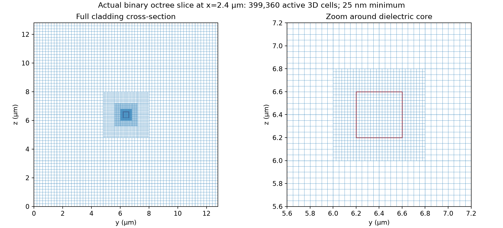
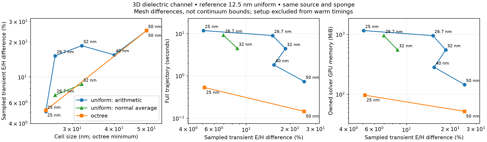
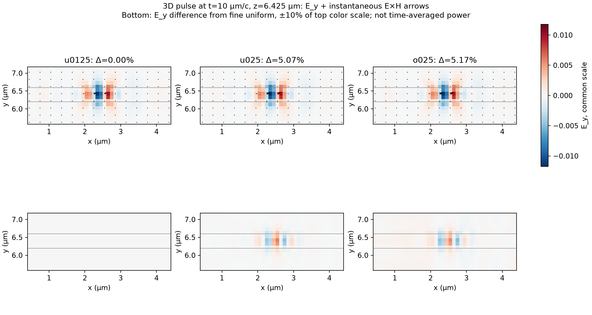

# Driven 3D octree waveguide comparison

This is the first actual octree/uniform propagation comparison, rather than a
cell-count estimate. It is a diagnostic prototype: the sponge breaks normal-flux
consistency at coarse–fine interfaces ([#42](https://github.com/alecjacobson/warp-fdtd/issues/42)),
and the closed-patch accuracy/composite Gauss gates remain open. Warm trajectory
speedups do not establish a production-quality solver or a cold-start advantage.

## Fixed physical problem

A 400 × 400 nm dielectric channel runs along x through a 4.8 µm-long box, with
relative permittivity 12.25 in the core and 2.25 in the cladding. The main comparison
uses a 12.8 × 12.8 µm transverse domain; the 6.4 µm comparison is retained as a
scaling control. These are full 3D field simulations, not a 2D effective-index model.

A localized impressed y-directed Gaussian current at x=0.8 µm excites a 1.55 µm
pulse. It is not a pure guided-mode source and can radiate and propagate in both
directions. Lengths are in µm, with c=μ=1; the full trajectory lasts 14 µm/c
(about 46.7 fs). Both solvers use the same source function (a positive electric forcing corresponds to negative impressed J), material-volume
averaging, physical geometry, exterior PEC and 0.4 µm matched-conductivity sponge.
The sponge is **not CPML**. No modal transmission or reflection claim is made.

The binary octree has 8³ cells per leaf block, a finest spacing of 25 nm, a
100 nm requested guide buffer and three refinement levels. Largest cells are
200 nm; adjacent blocks differ by at most one level, including edge/corner
neighbors. The actual generated mesh is saved with each adaptive result.



## Measured comparison

The raw data and derived comparison are in
[results/octree_guide_large](../results/octree_guide_large) and
[results/octree_guide_wide](../results/octree_guide_wide).
The following tables are derived from the archived JSON records.

**25 nm octree: 22.2× faster and 12.0× less solver GPU memory**
than uniform at the same finest spacing. That uniform grid also remains the fastest
tested configuration meeting the octree's sampled error, including the added
normal-averaging controls. This is a **~5% mesh-difference result**, not a sub-percent
or continuum-qualified result.

| Case / interface averaging | Active 3D cells | Warm trajectory (s) | Owned GPU (MiB) | Difference from 12.5 nm reference |
|---|---:|---:|---:|---:|
| u050 (arithmetic) | 6,291,456 | 0.7402 | 145.32 | 25.036% |
| u040 (arithmetic) | 12,288,000 | 1.8241 | 283.31 | 15.491% |
| u032 (arithmetic) | 24,000,000 | 4.4181 | 552.53 | 18.587% |
| u032_normal (normal average) | 24,000,000 | 4.4845 | 552.53 | 8.668% |
| u0267 (arithmetic) | 41,472,000 | 9.0045 | 953.84 | 15.190% |
| u0267_normal (normal average) | 41,472,000 | 9.1397 | 953.84 | 6.977% |
| u025 (arithmetic) | 50,331,648 | 11.7741 | 1157.26 | 5.070% |
| o050 (arithmetic) | 227,328 | 0.1455 | 51.98 | 25.042% |
| o025 (arithmetic) | 399,360 | 0.5300 | 96.63 | 5.170% |

The 402,653,184-cell reference took **195.79 s** for its
single diagnostic trajectory. It owned 9.686 GB of GPU arrays
and reached 14.529 GB CUDA-pool high-water with
time-centering scratch. No reference throughput median is reported.

For the 25 nm comparison, octree timings range 0.529707–0.530013 s;
uniform timings range 11.773815–11.774324 s. Solver-only
CUDA-pool high-water equals owned bytes in these cases. With diagnostics, peaks are
110.89 MB octree and 1823.47 MB uniform.
**Host** maximum RSS is 2.95 GB octree versus
0.32 GB uniform: the GPU memory saving is not a claim
of smaller total host+device memory.

Octree host setup takes **33.31 s**, versus **0.078 s** uniform;
capture/compilation costs are separately archived. A single fresh solve is therefore
slower on the current octree implementation. Reusing geometry amortizes that cost;
[#43](https://github.com/alecjacobson/warp-fdtd/issues/43) tracks first-run performance.

The smaller 6.4 µm cladding case measures 6.67× warm speedup and 3.57× less owned
GPU memory. At 3.2 µm width and 50 nm cells, the optimized octree is actually slightly
slower than uniform (0.988×) and uses more GPU memory (10.87 versus 9.64 MB). This
negative control is retained in `results/octree_guide_controls`: large savings
depend on there being enough quiet cladding to coarsen.

The full large-domain normal-flux mismatch is **5.167e-04** relative L2,
so the driven constraint gate **fails** even though the undamped operator rate
residual is 1.39e-17.






The field images show E_y and instantaneous E×H on the same physical slice, at
10 µm/c. They are not complex phasors or time-averaged power. The lower row shows
differences on a color scale ten times more sensitive than the upper row.

## Measurement and error definitions

- Direct structured second-order Yee is the uniform baseline. Both flat and 3D
  launch layouts were implemented; the faster 3D layout is used in the main
  comparison. For the 3.2 µm domain at 25 nm it reduced the median from 2.463 s to
  0.741 s with the same field storage. The repository's fourth-order propagator
  currently supports homogeneous periodic cases, not this dielectric/sponge test.
- The octree uses block-local curl kernels, electric trace prolongation, its
  transpose and a consistent electric mass inverse. Applying the two interface
  operators separately avoids storing their larger product. It remains a
  prototype with sparse interface metadata and duplicated block boundary fields.
- Both solvers use float32, a global fine-grid timestep, and the same effective
  CFL factor (at most 0.7). Step counts are rounded to multiples of seven so that
  observations occur at exactly 6, 10 and 14 µm/c. There is no local time stepping.
- Each timed case uses one fresh process, compilation/capture, one untimed full
  warm trajectory, then five serial synchronized full trajectories on the same
  RTX PRO 6000 Blackwell MIG 1g.24gb partition. Source and sponge updates are timed.
  Reset, setup, compilation, observer setup and a separate diagnostic trajectory
  are excluded from warm timings and recorded separately. The fine reference
  runs only its diagnostic trajectory and has no invented warm timing.
- Owned GPU bytes include fields, source/loss coefficients, sparse metadata,
  scratch, waveform and counter. CUDA memory-pool high-water values are separately
  recorded before/after diagnostics. These do not claim to measure driver context,
  graph internals or total device memory. Host maximum RSS is also recorded.
- Error is an epsilon-weighted E/H relative L2 difference, combined over three
  times at common physical points, spaced 0.1 µm in a near-guide volume spanning
  x=0.45…4.35 µm and ±0.775 µm transversely. H is time-centered by averaging its current value with one extra magnetic
  update; the physical simulation state is restored afterward. Spatial sampling is
  trilinear, with linear extrapolation within local boundary cells. The sampler
  passes an independent affine-exactness test, but this is a **sampled near-guide
  norm**, not a full-domain error bound. Core, cladding, downstream and per-time
  errors are also saved in the comparison JSON.
- “Accuracy-matched” means the fastest **tested** uniform mesh whose sampled norm
  is no worse than the octree's. It does not claim exhaustive optimization over
  uniform discretizations. Both finest-spacing and tested-accuracy comparisons
  are saved. Differences from the 12.5 nm reference are not continuum error bounds.

## Additional controls

Halving the timestep at 25 nm changes the uniform and octree sampled fields by
0.3497% each. Their differences from the reference become 5.412% and 5.507%; the
increase shows spatial/temporal error cancellation, so we do not subtract these
numbers to invent a continuum error bound.

Normal-component harmonic averaging reduces the 26.67 nm uniform difference from
15.19% to 6.98%. It still does not meet the 25 nm octree's 5.17% sampled tolerance.
The planar normal/tangential rule follows the principle documented in
[Meep's subpixel-smoothing discussion](https://meep.readthedocs.io/en/latest/Subpixel_Smoothing/).
The implemented rectangular-corner control uses sequential axis mixing, not a
full general-geometry tensor method. The aligned 25 nm guide has no normal-component
cut cells; its arithmetic rule agrees with the normal-average rule there, up to
floating-point error. Translation/corner and higher-order controls remain in
[#44](https://github.com/alecjacobson/warp-fdtd/issues/44).

Separating the interface operators speeds the small octree control by 1.67× and
reduces its GPU arrays by 1.44×, with a sampled field difference of 4.38e-7 relative.
The direct uniform 3D launch is 3.32× faster than the flat control at 25 nm, with
2.79e-6 relative field difference. These controls prevent crediting the octree
with a deliberately weak dense baseline.

## Verification and remaining gates

The block update matches the original sparse correctness operator in double
precision; uniform partitions match the direct driven kernel. Independent tests
check sampling affine exactness, observer passivity, flat/3D uniform parity,
CUDA/CPU parity, graph source counters and reset/repeat behavior. The sampled fields remain finite; a separate 10×-duration octree run checks all
E/H values on the GPU for nonfinite entries and is archived as `o025_long`. All
values were finite after 9,240 steps (140 µm/c); the maximum sampled post-pulse
field was 4.38e-5. This is not an energy/Gauss or boundary-reflection proof.

The undamped binary operator preserves matching normal flux to roundoff, but
pointwise sponge damping does not commute with coarse-face averaging. The measured
driven residual is reported above and is a **failed gate**, tracked by #42.
Full electric Gauss/source-charge continuity, boundary reflection, pure-mode
launch/ports, long-time behavior and sub-percent reference accuracy remain open
under [#15](https://github.com/alecjacobson/warp-fdtd/issues/15),
[#37](https://github.com/alecjacobson/warp-fdtd/issues/37) and
[#40](https://github.com/alecjacobson/warp-fdtd/issues/40).

CPU sparse assembly dominates the octree's first solve. Removing that bottleneck,
without hiding cold cost behind a cache, is tracked in
[#43](https://github.com/alecjacobson/warp-fdtd/issues/43).
Further GPU interface/layout work is in
[#41](https://github.com/alecjacobson/warp-fdtd/issues/41), and the overall experiment
remains open in [#35](https://github.com/alecjacobson/warp-fdtd/issues/35).

## Reproduction

Run GPU cases serially. Timed comparison runs take five timing repetitions
plus warmup and diagnostics; the 402.7M-cell reference runs once for diagnostics.
It uses about 14.5 GB of CUDA pool memory including time-centering scratch.

```bash
OPENBLAS_NUM_THREADS=1 .venv/bin/python -m unittest \
  tests.test_block_mesh tests.test_block_operator tests.test_driven_guide -v
OPENBLAS_NUM_THREADS=1 .venv/bin/python -m unittest tests.test_driven_cuda -v

OPENBLAS_NUM_THREADS=1 .venv/bin/python -m warp_fdtd.guide_benchmark \
  --kind octree --spacing .025 --levels 3 --block-cells 8 --width 12.8 \
  --output results/octree_guide_large/o025
for h in 050 040 032 025; do
  OPENBLAS_NUM_THREADS=1 .venv/bin/python -m warp_fdtd.guide_benchmark \
    --kind uniform --spacing "0.$h" --width 12.8 \
    --output "results/octree_guide_large/u$h"
done
OPENBLAS_NUM_THREADS=1 .venv/bin/python -m warp_fdtd.guide_benchmark \
  --kind uniform --spacing .0125 --width 12.8 --reference-only \
  --output results/octree_guide_large/u0125
OPENBLAS_NUM_THREADS=1 .venv/bin/python -m warp_fdtd.guide_benchmark \
  --kind uniform --spacing .02666666666666667 --width 12.8 \
  --output results/octree_guide_large/u0267
OPENBLAS_NUM_THREADS=1 .venv/bin/python -m warp_fdtd.guide_benchmark \
  --kind uniform --spacing .02666666666666667 --width 12.8 --normal-average \
  --output results/octree_guide_large/u0267_normal
OPENBLAS_NUM_THREADS=1 .venv/bin/python -m warp_fdtd.guide_benchmark \
  --kind uniform --spacing .032 --width 12.8 --normal-average \
  --output results/octree_guide_large/u032_normal
OPENBLAS_NUM_THREADS=1 .venv/bin/python -m warp_fdtd.guide_benchmark \
  --kind octree --spacing .05 --levels 2 --block-cells 8 --width 12.8 \
  --output results/octree_guide_large/o050
OPENBLAS_NUM_THREADS=1 .venv/bin/python -m warp_fdtd.guide_report results/octree_guide_large
```

Use `--width 6.4` for the smaller-domain scaling control. Use `--cfl .35 --reference-only` on the 25 nm uniform and octree cases for timestep-halving
controls. `--uniform-layout flat` and `--coupling fused` retain the slower initial
implementations for reproducible controls. Each result records its source hashes,
commit, physical parameters, raw timing samples and saved field checksum.

To reproduce the long-trajectory check:

```bash
OPENBLAS_NUM_THREADS=1 .venv/bin/python -m warp_fdtd.guide_benchmark \
  --kind octree --spacing .025 --levels 3 --block-cells 8 --width 12.8 \
  --duration 140 --reference-only --output results/octree_guide_controls/o025_long
```
