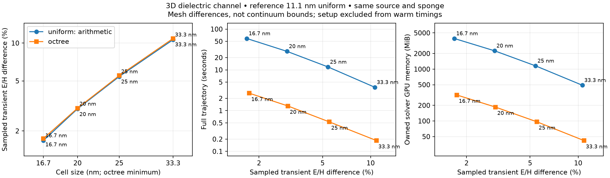
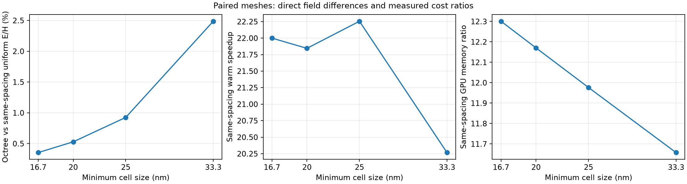

# Paired refinement of the 3D waveguide

This extends the [first octree comparison](octree-guide.md) with matched minimum
spacings of **33.33, 25, 20 and 16.67 nm**. Every case uses the same 4.8 × 12.8 ×
12.8 µm dielectric guide, impressed pulse, conductivity sponge, 14 µm/c duration,
float32 arithmetic and physical observation points. The numerical solver has not
changed for this sweep; the known sponge/interface flux defect remains open in
[#42](https://github.com/alecjacobson/warp-fdtd/issues/42).

## Controlled mesh family

All four octrees contain exactly the same **780 physical leaf blocks**, with the
same root lattice, origin, leaf indices and levels. Each root is 1.6 µm wide, the
finest leaf is 0.2 µm wide, and every case has three binary refinement levels.
Increasing cells per block from 6³ to 8³, 10³ and 12³ refines the fields without
moving refinement interfaces or changing the physical guide buffer. The coarsest
cell is eight times the finest cell in each case. This block-size choice is part
of the measured implementation; no constant-per-cell performance assumption is
made.

| Minimum spacing | Cells per leaf | Octree active cells | Uniform cells |
|---|---:|---:|---:|
| 33.33 nm | 6³ | 168,480 | 21,233,664 |
| 25 nm | 8³ | 399,360 | 50,331,648 |
| 20 nm | 10³ | 780,000 | 98,304,000 |
| 16.67 nm | 12³ | 1,347,840 | 169,869,312 |

All core widths contain an even integer number of cells, avoiding the
normal-component cut-cell ambiguity that affected some of the earlier off-grid
uniform controls. The arithmetic material rule is unchanged. This is a deliberately
aligned convergence family; the off-grid negative controls remain in the original
report, and translation/orientation robustness is still tracked in #44. The global timestep
is refined with the minimum cell size at the same maximum CFL factor, rounded to
hit the same three observation times exactly.

## Results

| Minimum cell | Uniform field Δ | Octree field Δ | Uniform time | Octree time |
|---|---:|---:|---:|---:|
| 33.3 nm | 10.63% | 10.87% | 3.739 s | 0.185 s |
| 25 nm | 5.41% | 5.51% | 11.791 s | 0.530 s |
| 20 nm | 3.00% | 3.03% | 28.424 s | 1.301 s |
| 16.7 nm | 1.68% | 1.74% | 58.816 s | 2.673 s |

These are **same-minimum-spacing** comparisons at comparable sampled accuracy,
not strictly equal error. Both methods improve monotonically across this sweep;
the octree remains slightly less accurate at each identical minimum spacing.

| Minimum cell | Uniform GPU (MiB) | Octree GPU (MiB) | Warm speedup | GPU memory ratio | Direct octree/uniform field Δ |
|---|---:|---:|---:|---:|---:|
| 33.3 nm | 489.0 | 41.9 | 20.27× | 11.66× | 2.487% |
| 25 nm | 1,157.3 | 96.6 | 22.26× | 11.98× | 0.925% |
| 20 nm | 2,258.2 | 185.5 | 21.85× | 12.17× | 0.529% |
| 16.7 nm | 3,899.8 | 317.0 | 22.00× | 12.30× | 0.355% |

For strict measured error budgets, the additional points support the following
comparisons. Each selected octree has a reference difference **no greater than**
the corresponding uniform case; no interpolation is used.

| Uniform case | Selected octree | Uniform Δ | Octree Δ | Speedup | GPU memory ratio |
|---|---|---:|---:|---:|---:|
| 33.3 nm | 25 nm | 10.63% | 5.51% | 7.06× | 5.06× |
| 25 nm | 20 nm | 5.41% | 3.03% | 9.06× | 6.24× |
| 20 nm | 16.7 nm | 3.00% | 1.74% | 10.63× | 7.12× |

No tested octree meets the finest 16.67 nm uniform case's error budget; a finer
adaptive point would be required. These comparisons demonstrate meeting an error
budget, not exact equality of errors or continuum accuracy.

The new reference differs from the previous 12.5 nm reference by **0.3825%**.
Both reference choices preserve the convergence trend and method ordering.
Accordingly, the 25 nm differences have changed from 5.07%/5.17% to
5.41%/5.51% solely because this report uses the finer reference. The 25 nm
reruns reproduce the archived fields exactly and their median times within 0.15%.

The 11.11 nm reference completed its diagnostic trajectory in
**336.38 s**, owning 13.787 GB of GPU arrays and
reaching 20.680 GB of CUDA-pool high-water. All new runs pass the
full-field finiteness check.

Setup remains CPU-based and is excluded from warm timings:

| Minimum cell | Octree setup (s) | Octree process peak host RSS (GB) | Driven normal-flux residual |
|---|---:|---:|---:|
| 33.3 nm | 14.57 | 1.37 | 9.065e-04 |
| 25 nm | 34.81 | 2.94 | 5.167e-04 |
| 20 nm | 70.05 | 5.49 | 3.319e-04 |
| 16.7 nm | 123.73 | 9.32 | 2.597e-04 |

The flux residual decreases with refinement but remains a **failed consistency
gate**; it has not become roundoff-level. Host assembly still makes a fresh
one-shot solve slower. These setup values are single measurements, not medians.
The CPU-memory and boundary limitations are not hidden by the GPU speedup.







## Reference and comparison scope

An additional **11.11 nm uniform reference** uses 573,308,928 cells. The archived
12.5 nm / 402,653,184-cell reference is retained as a reference-sensitivity check.
Neither reference-only case receives an invented timing median or appears as a
zero-error point on a convergence curve. The `reference_checks.json` artifact
records the difference between references, including each observation time.
`reference_sensitivity.json` recomputes every timed case against both references,
so changes of reference can be inspected without rerunning the trajectories.
Finite-reference differences are not continuum error bounds; no convergence
order is fitted against the finite reference.

The sampled near-guide E/H norm and H time-centering are unchanged from the
[original measurement definition](octree-guide.md#measurement-and-error-definitions).
The direct octree/uniform difference at each spacing is reported separately, so
it can be inspected without depending on the finest reference. Core, cladding,
downstream and per-time differences remain in `comparison.json`.

Each performance point contains five serial synchronized warm full trajectories
on the same RTX PRO 6000 Blackwell MIG 1g.24gb partition. Timings include source and
sponge updates and exclude reset, compilation/capture, host setup and the separate
diagnostic trajectory. Setup, owned GPU memory, CUDA-pool peaks and host maximum
RSS are archived separately. These are forward simulation measurements, not a
pure-mode transmission, optimization/adjoint or one-shot end-to-end comparison.

Accuracy-budget comparisons use **actual measured configurations**: for a given
uniform case, choose the fastest octree case whose sampled reference difference
is no worse. They do not interpolate an equal-error runtime between points.
The converse comparisons are also saved. Thus the new points can distinguish
same-spacing comparisons from strict measured error-budget comparisons.

## Reproduction

Run the GPU jobs serially. The finest adaptive setup uses substantial host RAM;
the 11.11 nm reference needs roughly 20.7 GB of CUDA-pool memory including the
observer's H-centering scratch.

```bash
for spec in '0.03333333333333333 6 0333' '0.025 8 025' '0.02 10 020' '0.016666666666666666 12 0167'; do
  read -r h b label <<< "$spec"
  for method in uniform octree; do
    prefix=u
    if [ "$method" = octree ]; then prefix=o; fi
    OPENBLAS_NUM_THREADS=1 .venv/bin/python -m warp_fdtd.guide_benchmark \
      --kind "$method" --spacing "$h" --block-cells "$b" --levels 3 --width 12.8 \
      --output "results/octree_guide_refinement/${prefix}${label}"
  done
done
OPENBLAS_NUM_THREADS=1 .venv/bin/python -m warp_fdtd.guide_benchmark \
  --kind uniform --spacing .011111111111111112 --width 12.8 --reference-only \
  --output results/octree_guide_refinement/u0111
OPENBLAS_NUM_THREADS=1 .venv/bin/python -m warp_fdtd.guide_report \
  results/octree_guide_refinement --reference u0111
OPENBLAS_NUM_THREADS=1 .venv/bin/python -m unittest tests.test_guide_report -v
```

The copied 12.5 nm reference files are byte-identical to the original archived
reference. All source hashes, raw timing samples and field checksums are recorded
per case. This sweep is tracked in [#46](https://github.com/alecjacobson/warp-fdtd/issues/46);
physical qualification and setup/backend optimization remain in #35, #40–44.
