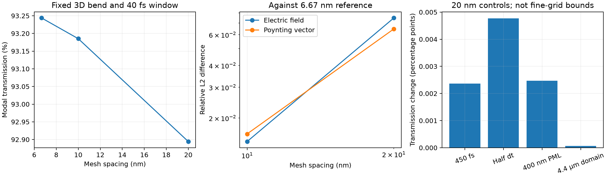
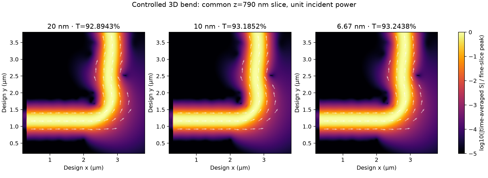

# Controlled 3D bend references

The `fixed_physical_v1` protocol addresses [#25](https://github.com/alecjacobson/warp-fdtd/issues/25).
It separates new mesh-convergence experiments from the archived same-input
Warp/FDTDX performance comparisons. The latter remain valid engine comparisons,
but their source/output positions and durations differ across resolutions.

The reference problem is the saved optimized 3D silicon bend, with the same
80×80 latent design, Gaussian filter, projection beta 50 and pinned unmodified
FDTDX revision. In a common design frame, device bounds are
x=[2000,3600], y=[400,2000], z=[600,1000] nm; source, input and output plane
anchors are respectively x=300, x=400 and y=3600 nm. These are integer Yee-grid
anchors; the individual components and the TFSF cut retain their staggered
locations within a cell. Actual object placements are checked and exported.

The field meshes are 20, 10 and 20/3 nm, with 200 nm of PML, 300 fs duration
and a Hann window over [260,300] fs. Refinement holds the latent grid fixed;
FDTDX's subpixel material projection is reevaluated at each field resolution.
That material approximation remains part of the mesh error. The 25 nm setup
attempt in `results/physical_reference/mesh25/result.json` failed because
upstream rounds the latent voxel width to an integer field-cell count, changing
the parameter grid. The protocol now rejects such spacings before setup.

Four separate 20 nm controls change duration to 450 fs (last 40 fs window),
CFL to half, PML thickness to 400 nm with external padding, and lateral domain
to 4.4 µm. Padding translates the design frame while keeping device and port
coordinates fixed within it. These coarse-grid controls are diagnostics;
they do not bound nuisance errors at the finest mesh.

## Reproduce

Use the environment and pinned upstream checkout in [the baseline instructions](fdtdx-baseline.md).
Run the stages serially on one GPU:

```bash
OPENBLAS_NUM_THREADS=1 taskset -c 0-3 .venv/bin/python -m baseline.reference_study
OPENBLAS_NUM_THREADS=1 .venv/bin/python -m warp_fdtd.reference_report
```

`--cases mesh20 mesh10 mesh6p67` selects only spatial levels. Missing arrays,
input bundles or volume chunks are regenerated; metadata alone is not a
complete cache. Existing candidate/settings mismatches are rejected. Use
`--root` for a separate study directory. The driver uses `JAX_PLATFORMS=cuda,cpu`
because upstream mode setup needs a CPU callback, and disables GPU preallocation.

`--reference-only` performs one FDTDX reference trajectory and records it as
such. Neither that timing nor the passive volume observer's timing is a warmed
throughput benchmark. Performance claims continue to use repeated synchronized
runs of `warp_fdtd.benchmark` against warmed FDTDX fixtures; that command rejects
reference-only bundles.

## Full 3D comparison

The Warp volume observer samples six complex phasors at the same physical
points with 20 nm spacing, accounting for Yee staggering and centering H in
time. Comparisons exclude the original PML region, using x/y=[200,3800] nm
and z samples [210,1290] nm. Padded cases are translated back into the common
design frame. No interpolation is used between stored volume samples.

Each field is divided by its incident-mode amplitude and the eigenmode's
canonical phase, determined by the dominant integrated electric component at
the input port. The extra grid-spacing factor converts upstream's uniform
grid-weighted unit mode power to unit area-weighted incident power. The synthetic
normalization test varies source amplitude, eigenmode phase and mesh size
independently. No phase or scale is fitted to the propagated/reference field.
A changed dominant polarization rejects a comparison.

Electric-field relative L2 uses the finest scalar epsilon as fixed weights,
piecewise constant in the cell containing each common sample. Magnetic-field
and time-averaged Poynting-vector relative L2 are also reported. The reference
modal measurements come from FDTDX; volume phasors come from the independently
validated same-input Warp implementation. Volume records check modal parity
against FDTDX, and carry source/input/chunk hashes. Large regenerable volume
chunks and FDTDX field caches are excluded from Git.

`comparison/result.json` and `comparison/convergence.png` report differences,
not a certified continuum error bound. Three mesh levels alone do not prove
asymptotic convergence for a projected dielectric geometry. The bend acceptance
budget still requires reference uncertainty below one third of each tolerance:
|ΔT|≤1e-3, |ΔR|≤1e-4, electric-field L2≤1%, Poynting L2≤2%. Fine-grid nuisance
controls and any further refinement needed to establish that uncertainty remain
under [#13](https://github.com/alecjacobson/warp-fdtd/issues/13).

## Measured fixed-geometry results

| Mesh | Cells | Modal T | Electric-field L2 vs 6.67 nm | Poynting L2 vs 6.67 nm |
|---|---:|---:|---:|---:|
| 20 nm | 3,000,000 | 92.8943% | 7.488% | 6.478% |
| 10 nm | 24,000,000 | 93.1852% | 1.468% | 1.623% |
| 6.67 nm | 81,000,000 | 93.2438% | 0.000% | 0.000% |

The finest row is zero by definition, not an error-free reference. The remaining
uncertainty, finer sampling quadrature and fine-grid nuisance controls are tracked
in [#30](https://github.com/alecjacobson/warp-fdtd/issues/30).

| 20 nm control | Absolute change in T | Electric-field relative L2 | Poynting relative L2 |
|---|---:|---:|---:|
| time20_450 | 2.366e-05 | 2.241e-05 | 2.042e-05 |
| cfl20_half | 4.774e-05 | 3.222e-03 | 7.623e-05 |
| pml20_400 | 2.474e-05 | 1.134e-03 | 7.280e-04 |
| domain20_4p4 | 6.557e-07 | 9.815e-05 | 3.186e-05 |

The timestep control illustrates why modal power alone is insufficient: its
complex-field difference is larger than its power difference. These controls
are measured at 20 nm and do not certify the fine-grid uncertainty.





## Further reference refinement (#30)

The opt-in 5 nm case has 192M cells. The 81M-cell run measured 8.654 GB peak
live JAX allocation; further refinement must be checked against actual allocator
capacity. The following explicitly raises the allocator limit, with preallocation
still disabled. It is a capacity/accuracy experiment, not a default workload or
a promised passing reference. Its environment and peak allocation are recorded.

```bash
XLA_PYTHON_CLIENT_ALLOCATOR=cuda_async OPENBLAS_NUM_THREADS=1 \
  taskset -c 0-3 .venv/bin/python -m baseline.reference_study \
  --cases mesh5 --jax-memory-fraction 0.9
# After completion, compare the three finest levels:
OPENBLAS_NUM_THREADS=1 .venv/bin/python -m warp_fdtd.reference_report \
  --mesh-cases mesh10 mesh6p67 mesh5 --controls
```

The existing 20/10/6.67 nm report remains the published result until the finer
run completes and is reviewed. A three-fine-level report still requires the
uncertainty and observation-quadrature checks in #30.

The first 192M-cell attempt with the default BFC allocator and fraction 0.9
failed while allocating a 6.46 GiB temporary buffer. Its record is preserved in
`results/physical_reference/rejected_mesh5_bfc90/result.json`. The supported
`cuda_async` allocator above is a controlled retry; it does not change numerical
settings. Finer-reference success and peak memory remain unconfirmed until the
trajectory completes.
