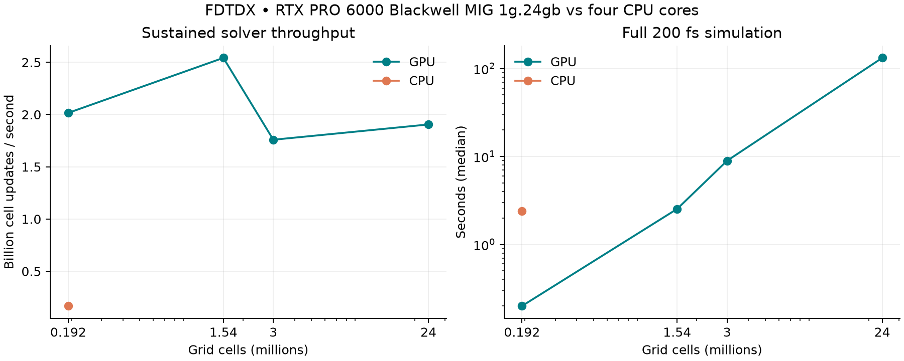
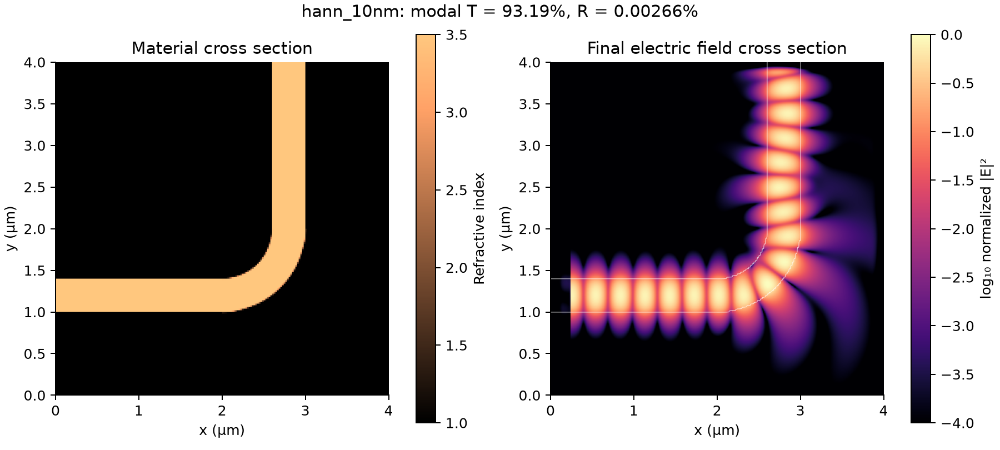

# Measured FDTDX baseline

Hardware: RTX PRO 6000 Blackwell **MIG 1g.24gb (46 SMs)**; CPU allocation: four cores, 16 GiB host memory.
Upstream: `2cab8dbb2af9a43ec6443712f011f50ecf58790b`; JAX 0.12.0; float32 unless identified otherwise.

This is a measured single-partition solver and optimized-bend baseline. It is not a reproduction of the paper's five-seed optimization campaign or multi-GPU capacity result.

**Validated bend: 93.19% modal transmission at 1550 nm.** All six independent quality gates pass; see [the saved gate results](quality_checks.json).

## Complete forward simulations

All rows use 200 fs and the same physical bend domain. Values are synchronized medians excluding compilation and warmup.

These throughput cases use 10-cell PMLs, deterministic random devices and legacy flux monitors. Each mesh is a separate workload; convergence is evaluated separately with the saved optimized candidate and fixed physical PML thickness.

| Backend | Cells | Steps | Median (s) | Min–max (s) | GCUPS | JAX peak (GB) |
|---|---:|---:|---:|---:|---:|---:|
| cpu | 192,000 | 2,098 | 2.399 | 2.357–2.470 | 0.168 | n/a |
| gpu | 192,000 | 2,098 | 0.200 | 0.199–0.201 | 2.016 | 0.135 |
| gpu | 1,536,000 | 4,196 | 2.535 | 2.523–2.551 | 2.542 | 0.194 |
| gpu | 3,000,000 | 5,245 | 8.946 | 8.785–8.968 | 1.759 | 0.260 |
| gpu | 24,000,000 | 10,490 | 132.144 | 132.105–132.244 | 1.905 | 1.438 |

## Numerical checks

Upstream analytic GPU tests: 6/6 passed.

CPU/GPU parity: **PASS**; worst relative L2 error 0.000254; matched-case speedup 12.00×.

| Recorder | Relative gradient L2 error vs checkpointed | Cosine | Best directional FD error | Gate |
|---|---:|---:|---:|---|
| exact | 5.862e-06 | 1.0000000000 | 8.346e-05 | PASS |
| paper | 0.005746 | 0.9999992981 | 0.007555 | PASS |
| compressed | 0.04728 | 0.9999561593 | 0.02995 | FAIL |

The float8/every-five-step recorder fails the 1% directional-derivative gate on this case. Use the exact segmented path as the accuracy reference; accept the faster frequency adjoint only on matched cases where its gradient gate passes.

Float64-field/parameter diagnostic finite differences (detectors retain float32; not a float32 speed benchmark):

| h | Relative error |
|---:|---:|
| 0.1 | 0.00024403 |
| 0.03 | 2.4235e-05 |
| 0.01 | 9.2574e-07 |
| 0.003 | 7.2081e-06 |
| 0.001 | 1.7224e-05 |

Full 3-million-cell exact gradient: **54.67 s**, 4.33 GB peak allocator use.

`frequency_adjoint`: **PASS**, relative L2 gradient error 0.003915 versus exact segmented reconstruction.

`frequency_adjoint_full`: **PASS**, relative L2 gradient error 0.0004486 versus exact segmented reconstruction.
Matched full-resolution gradient speedup: 2.19×.

`frequency_adjoint_hann`: **PASS**, relative L2 gradient error 0.0005295 versus exact segmented reconstruction.
Matched full-resolution gradient speedup: 2.20×.

Validated Hann-objective gradient costs (same saved 3-million-cell design):

| Method | Median (s) | Peak JAX allocation (GB) |
|---|---:|---:|
| exact | 55.468 | 4.334 |
| adjoint | 25.208 | 0.530 |

## Capacity stress (not a physical transmission evaluation)

192,000,000 cells × 1,000 steps, 111.54 s median, 1.721 GCUPS, 10.75 GB peak JAX allocation. This short prefix establishes capacity and finite-field behavior only.

## Device quality

Legacy core flux and late-time fundamental-mode transmission are distinct measurements.

| Run | Grid (nm) | Time (fs) | Legacy flux ratio | Modal T | Modal R |
|---|---:|---:|---:|---:|---:|
| bend_flow20 | 20 | 300.0 | 1.24564 | 0.92893 | 0.00001 |
| hann_10nm | 10.0 | 300.0 | 1.25424 | 0.93192 | 0.00003 |
| hann_200fs | 20 | 200.0 | 1.23974 | 0.92897 | 0.00001 |
| hann_300fs | 20 | 300.0 | 1.24564 | 0.92893 | 0.00001 |
| hann_400fs | 20 | 400.0 | 1.24236 | 0.92896 | 0.00001 |
| hann_straight20 | 20 | 200 | 1.29913 | 1.00005 | 0.00001 |
| hann_thicker_pml | 20 | 300.0 | 1.24534 | 0.92894 | 0.00001 |
| quality_200fs | 20 | 200.0 | 1.23974 | 0.92172 | 0.00001 |
| quality_300fs | 20 | 300.0 | 1.24564 | 0.93957 | 0.00001 |
| quality_400fs | 20 | 400.0 | 1.24236 | 0.92745 | 0.00001 |
| quality_thicker_pml | 20 | 300.0 | 1.24534 | 0.93958 | 0.00001 |
| ring20_initial | 20 | 200 | 1.23649 | 0.91029 | 0.00001 |
| straight20_calibration | 20 | 200 | 1.29913 | 0.99607 | 0.00001 |

Optimization `ring20_optimized`: complete, 20 saved evaluated steps.
Initial objective 0.91029; best 0.92172.

Rectangular-window duration gate: **FAIL**, 1.785 percentage-point variation. This motivated the built-in Hann-window evaluation; the candidate and thresholds were unchanged.

## Independent quality gates

Overall (hann window): **PASS**.

- straight_calibration: PASS
- time_convergence: PASS
- pml_convergence: PASS
- mesh_convergence: PASS
- same_physical_material_cross_section: PASS
- fine_mesh_quality_target: PASS

Duration change: 0.0044 percentage points; PML change: 0.0014; mesh change: 0.2990.

## Additional diagnostics

[Cycle-averaged bend Poynting flow](bend_flow20/poynting_flow.png) shows a central-plane projection from co-located, time-centered phasors; adding the passive detector left transmission unchanged.

[Analytic Maxwell-mode accuracy trends](convergence/accuracy_trends.png) separate joint mesh/time refinement from time-step error at fixed mesh. These are measured GPU runs with an analytic reference; methods and limits are in README.md.

## Limits

- No multi-GPU or billion-cell result was measured on this partition.
- A curved-guide initialization and modal objective do not reproduce the publication's five random-start binary/brush optimizations.
- A finite optimized objective alone does not certify 92% physical efficiency, fabrication constraints, mesh/time/PML convergence, or independent-solver agreement.
- The smooth projected design is not certified to meet the publication's binary/100 nm brush fabrication constraint. Independent-solver validation remains for the Warp comparison.
- Peak JAX allocation is not total GPU memory. MIG isolation does not establish exclusive use of all parent-device resources.
- Source, methodology, reproduction commands, and the Warp comparison contract are in [README.md](../README.md).
